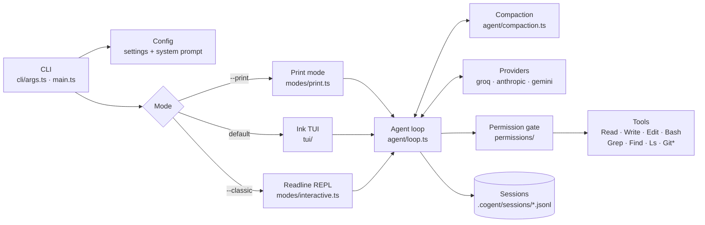
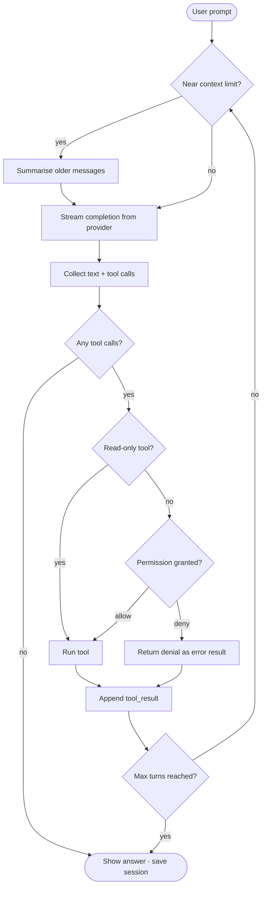

# cogent

A minimal terminal coding agent. It streams a model's reply, runs the tools the model asks for (read, write, edit, bash, grep, find, ls, git), feeds the results back, and repeats until the task is done. Works with **Groq** (default), **Anthropic**, and **Gemini**.

## Architecture



| Layer | Responsibility |
|---|---|
| `cli/`, `main.ts` | Parse flags, resolve provider/model, pick a mode |
| `config/` | Load `~/.cogent/settings.json` → `.cogent/settings.json` → env; build the system prompt (includes `AGENTS.md` / `CLAUDE.md` if present) |
| `modes/`, `tui/` | Render the agent's event stream (stdout, Ink TUI, or readline) |
| `agent/` | The loop itself, plus history compaction near the context limit |
| `providers/` | Adapt each SDK's stream into one common `StreamEvent` format |
| `permissions/` | Ask before running tools that change things (skipped with `--yolo` / `--print`) |
| `tools/` | Tool implementations; read-only tools never prompt |
| `session/` | Append every message to a JSONL file so runs can be resumed |

## Flow



## Run locally

Requires **Node 22+** and an API key for at least one provider.

1. **Clone and install**
   ```bash
   git clone https://github.com/AKjangid99/TerminalAgent.git
   cd TerminalAgent
   npm install
   ```
2. **Add your key(s)** — copy the template and fill in the provider(s) you'll use:
   ```bash
   cp .env.example .env
   # GROQ_API_KEY=...   ANTHROPIC_API_KEY=...   GEMINI_API_KEY=...
   ```
3. **Run from source**
   ```bash
   npm run dev                                   # interactive TUI
   npm run dev -- -p "list the files under src"  # one-shot answer
   ```
4. **Or build and run**
   ```bash
   npm run build
   npm start -- "explain what this project does"
   npm link        # optional: makes `cogent` available globally
   ```

## Usage

```bash
cogent                                   # interactive TUI
cogent -p "summarise src/agent/loop.ts"  # one-shot, prints to stdout
echo "fix the lint errors" | cogent -p   # prompt from a pipe
cogent --provider anthropic --model claude-sonnet-5 "refactor src/tools/grep.ts"
cogent --list-models                     # available models
cogent --list-sessions                   # saved sessions
cogent --session <id>                    # resume one
```

Other flags: `--classic` (plain REPL), `--yolo` (no permission prompts), `--context-limit <n>`, `--help`.

## Development

```bash
npm run check          # biome lint + format check
npm run format         # auto-format
npm run test:tools     # tool tests, no API key needed
npm run test:provider  # provider streaming (needs a key)
npm run test:agent     # full loop end to end (needs a key)
```

An interactive visual walkthrough of one agent run lives in [`demo/`](demo/README.md) (`cd demo && npm install && npm run dev`).
